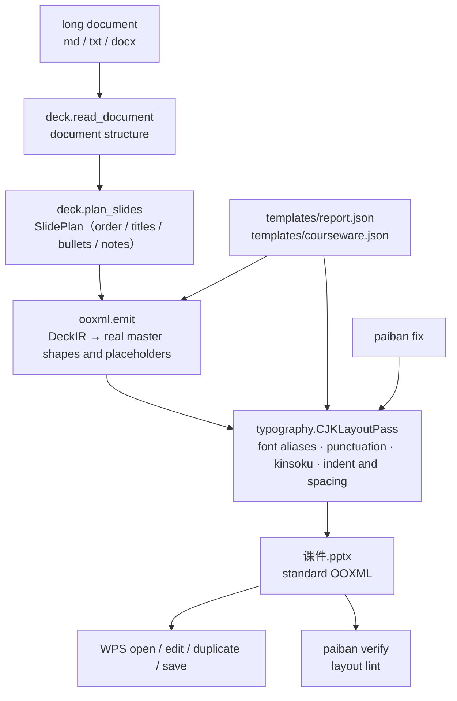

**English** | [简体中文](./README.md)

<div align="center">
  <a href="https://github.com/SuperMarioYL/paiban">
    
  </a>
</div>

<p align="center">
  <a href="https://github.com/SuperMarioYL/paiban/actions/workflows/ci.yml"></a>
  
  
  
  
</p>

<h3 align="center">Agents can turn long documents into decks. Paiban adds the Chinese typography layer.</h3>

<p align="center">
One command turns a course script or a report draft into a <code>.pptx</code> that WPS opens natively, edits in place and saves without breaking the layout.<br>
Font alias fallback, full-width punctuation compression, kinsoku, a two-character first-line indent and 1.5 line spacing — all written as OOXML attributes.
</p>

##  Why Paiban

Agents turning long documents into "native, editable decks" already works. But the generation layer assumes Latin letter spacing and Latin font metrics: Chinese needs alias-based font fallback, full-width punctuation has to be compressed, and paragraphs need Chinese indentation and line-spacing conventions. None of that is the generation layer's job, so the delivery step falls back from "generate" to "re-lay-out every page by hand" — missing glyph boxes, quotes that stretch the line, indents and line spacing that never line up.

Paiban covers the layer between generation and delivery: **a Chinese typography engine plus a WPS-native round trip**. It is not a translated clone of some other tool; it is a deterministic OOXML rewrite — run the same input twice and every attribute is identical.

Three boundaries, stated plainly:

- **The model only segments.** Slide order, titles, bullets and speaker notes can come from DeepSeek. Layout is always code; the model writes no OOXML attribute.
- **The output is standard OOXML.** Real master shapes and placeholders, no image fallback. It does not drive a WPS process and needs no plugin.
- **WPS is the delivery surface.** The declared target range is WPS Office 2019 and later (including WPS 365). That is a declared range, not a measured result — see [Known limitations](#known-limitations).

##  Install

Python 3.12 or later.

```bash
git clone https://github.com/SuperMarioYL/paiban
cd paiban
pip install -e .
```

The command name is `paiban`. Once the package is on PyPI you will be able to `pip install paiban`; until then, install from source.

To run the tests, add the dev extras: `pip install -e ".[dev]"`.

##  Quickstart

The repo ships a real course script at `fixtures/sample-longdoc.md`. These three commands are the whole first run — no API key needed, everything local, no server and no database:

```bash
paiban build fixtures/sample-longdoc.md -o 课件.pptx --template courseware   # long doc → deck
paiban verify 课件.pptx                                                     # layout lint
# double-click 课件.pptx in WPS: edit a paragraph, duplicate a slide, save
```

What `build` prints (recorded from a real run, see [docs/demo-results.json](./docs/demo-results.json)):

```text
输入      fixtures/sample-longdoc.md
模板族    courseware
页序来源  rules（未设置 DEEPSEEK_API_KEY，按文档结构规则切分）
页数      12（封面 1 + 内容 11）
改写      段落 55 / run 54 / 标点挤压 14 字
字体      别名表命中 0 / 写入默认族 54
lint      ok — 5 项检查全过
输出      课件.pptx
```

For slide order that follows the document's semantics more closely, set a key and run it again (optional, still well under 60 seconds):

```bash
export DEEPSEEK_API_KEY=sk-...
paiban build fixtures/sample-longdoc.md -o 课件.pptx --template courseware
```

`页序来源` then becomes `deepseek（deepseek-chat）`. **A missing key is not an error** — it falls back to deterministic rule-based splitting and prints why. Rule-based splitting only guarantees a usable slide order, not semantic quality.

##  Demo

Below is a real recorded terminal session (`docs/demo.tape`, rendered with vhs, 23 seconds): long document → `.pptx` → layout lint → open the file and confirm the attributes are actually in there.

<p align="center">
  
</p>

The full `paiban verify` report:

```text
文件      课件.pptx
复核范围  只复核 .pptx 里的 OOXML 属性，不渲染、不驱动 WPS 进程
规模      12 页 / 27 个文本容器 / 55 段 / 66 个 run
lint      ok — 5 项检查全过
          font_alias [ok] 65 个中文 run：65 个东亚字体槽已解析，0 个不在别名表，0 个没有东亚字体槽
          punct_compress [ok] 6 段含连续全角标点，其中 6 段已应用挤压（负字距）
          paragraph_layout [ok] 首行缩进：42 段达标 / 0 段未达标 / 13 段不适用；行距：55 段达标 / 0 段未达标；对齐不符 0 段
          kinsoku [ok] 避头尾（eaLnBrk）：55 段已开启，0 段未开启
          real_shapes [ok] 12 页中 12 页带真实占位符，图片 0 张（Paiban 生成物应为 0）
WPS 目标版本  WPS Office 2019 及以上（含 WPS 365）
未自动验证  以下结论只能在 WPS 里人工确认：
          1. 本机是否装了别名表里的字体，以及 WPS 实际选中了哪个字体来渲染中文
          2. 标点挤压与避头尾在 WPS 里的渲染结果（行首行尾半宽、禁则处理是否生效）
          3. 在 WPS 里改字 / 复制页 / 保存之后版式是否保持（需要人工往返一次）
```

You do not need WPS to confirm the layout really landed as attributes — read the XML in the file:

```bash
unzip -p 课件.pptx ppt/slides/slide2.xml | grep -oE '(a:ea typeface|spcPct val|indent)="[^"]*"' | sort -u
```

```text
a:ea typeface="Microsoft YaHei"
indent="558800"
spcPct val="150000"
```

The East Asian font slot is `Microsoft YaHei` (so Chinese never falls back to a missing glyph box), `indent="558800"` is the two-character first-line indent at 22 pt (2 × 22 pt × 12700 EMU/pt), and `spcPct val="150000"` is 1.5 line spacing.

> The CLI prints in Chinese; that is the primary locale. Every value you need to act on (plan source, template name, counts, paths) is machine-readable and stable.

##  Usage

### `paiban build`: long document → deck

```bash
paiban build 课程稿.md -o 课件.pptx --template courseware
```

| Argument | Meaning |
| --- | --- |
| `SOURCE` | Input document: `.md` / `.markdown` / `.txt` / `.docx` |
| `-o, --out` | Output `.pptx`; defaults to the input name with a `.pptx` suffix |
| `-t, --template` | Template family: `report` (default) or `courseware` |
| `--model` | DeepSeek model name, default `deepseek-chat` |

Slide order comes from the document structure: the cover uses the document title, each content slide is titled after its section, bullets come from that section's list items (prose paragraphs when there are none), and prose paragraphs become speaker notes. A slide holds at most six bullets; the overflow goes to a "（续）" (continued) slide instead of being dropped.

### `paiban verify`: layout lint

```bash
paiban verify 课件.pptx                 # judged against the built-in Chinese typography spec
paiban verify 课件.pptx -t courseware   # judged against one template family's parameters
```

| check | What it reads | What `warn` means |
| --- | --- | --- |
| `font_alias` | East Asian font slot of Chinese runs | A Chinese run has no East Asian slot, or its font is not in the alias table |
| `punct_compress` | Paragraphs with consecutive full-width punctuation | A paragraph that should be compressed has no negative character spacing |
| `paragraph_layout` | First-line indent / line spacing / alignment | Indent is not two characters, spacing is not 1.5, or alignment disagrees with the template |
| `kinsoku` | `eaLnBrk` | A paragraph does not explicitly enable East Asian line breaking and kinsoku |
| `real_shapes` | Placeholders and pictures | A slide has no placeholder, or the deck contains pictures |

Exit code is 0 when every check is `ok` and 1 when anything warns, so it can gate CI or a delivery step. Point it at a `.pptx` produced by another tool and the differences show up in the report.

### `paiban fix`: add the layout layer to an existing deck

```bash
paiban fix 外来稿.pptx                          # rewrite in place
paiban fix 外来稿.pptx -o 修好的.pptx -t report  # write elsewhere
```

Runs the same Chinese typography pass over an existing `.pptx` — useful when you start from someone else's template or another tool's output and still have to deliver it. Font aliases, punctuation compression, kinsoku and indent/line-spacing are rewritten from the template family's parameters. **Not one character of text changes**; compression only splits runs.

### Hand it to an agent

`skill/SKILL.md` is the manual this tool gives an agent: when to reach for it, how to run the three commands, what the output contract is, how to read a `verify` report, and which conclusions a human must confirm in WPS. Drop it into an agent host that supports the `SKILL.md` convention and then just ask:

```text
/paiban turn this course script into slides
```

The agent runs `build`, reads the plan source back (`deepseek` or the `rules` fallback), runs `verify`, and repeats the warnings instead of passing rule-based splitting off as model output.

##  Architecture

A single-process CLI with one entry point — no server, no database, no microservices:



| Module | Responsibility |
| --- | --- |
| `cli.py` | Entry point: `build` / `verify` / `fix` |
| `deck.py` | Document parsing, SlidePlan, template loading, layout review (`lint` / `verify`) |
| `typography.py` | The Chinese typography engine: font alias table, compression rules, `CJKLayoutPass` |
| `ooxml.py` | DeckIR → OOXML, plus the low-level read/write primitives for font slots and paragraph attributes |
| `templates/*.json` | Built-in template families: master layout mapping plus typography parameters |

`--model` and `--template` are the only knobs. The LLM affects slide order and nothing else.

##  Chinese typography rules

| Rule | Where it lands in OOXML |
| --- | --- |
| **Font alias fallback** | The alias table (微软雅黑 / 宋体 / 黑体 / 楷体 / 仿宋 / 等线 / 思源黑体 / 思源宋体, plus the East Asian slot of Latin families such as Arial / Calibri / Times New Roman / Consolas) resolves to the three font slots `<a:latin>` `<a:ea>` `<a:cs>`. A font outside the table keeps its Latin slot and only gets an East Asian slot, so Chinese never lands on an unusable font |
| **Punctuation compression** | Consecutive full-width punctuation (where either neighbour is also full-width punctuation) is compressed to half width: the run is split into segments and the compressed segments get a negative `<a:rPr spc>` |
| **Kinsoku** | `<a:pPr eaLnBrk="1">` enables East Asian line breaking and kinsoku; `<a:pPr hangingPunct="1">` lets punctuation hang past the line end. Line-break positions are left to the renderer — this layer does not guess them and does not change the text |
| **Paragraph layout** | A two-character first-line indent (converted to `<a:pPr indent>` from the paragraph's font size, since DrawingML has no "character" unit), 1.5 line spacing (`<a:lnSpc><a:spcPct val="150000"/>`), space before/after, and justified alignment |

The two built-in families differ in their typography parameters: `report` uses 18 pt body text with 6 pt space after, while `courseware` scales up one step for projection at 22 pt body text with 10 pt space after. Both declare their font size explicitly — without it the first-line indent falls back to a default size and is no longer exactly two characters.

##  Configuration

| Environment variable | Effect | Default |
| --- | --- | --- |
| `DEEPSEEK_API_KEY` | Enables DeepSeek semantic segmentation | Unset → deterministic rule-based splitting |
| `DEEPSEEK_BASE_URL` | OpenAI-compatible gateway | `https://api.deepseek.com` |

A template family is a JSON file holding both the master/placeholder mapping and the typography parameters:

```json
{
  "name": "courseware",
  "layouts": { "cover": 0, "content": 1, "section": 2, "end": 5 },
  "title": { "font": "微软雅黑", "font_size_pt": 40, "first_line_indent_chars": null,
             "line_spacing": 1.5, "space_before_pt": 0, "space_after_pt": 6, "alignment": null },
  "body":  { "font": "微软雅黑", "font_size_pt": 22, "first_line_indent_chars": 2,
             "line_spacing": 1.5, "space_before_pt": 0, "space_after_pt": 10, "alignment": "just" }
}
```

`layouts` values are master `slide_layout` indices; the keys under `title` / `body` are the typography parameter fields. Omitted fields keep their defaults, and `null` means "do not write this attribute, keep the master's inheritance". The full schema is in the `deck.load_template()` docstring. v0.1 ships these two families and does not import external templates.

##  Pricing

The core CLI, the typography engine and the two built-in template families are MIT-licensed: run them locally with your own DeepSeek key. The paid side has two parts — **template families** and **hosted per-run** — and only the first is available today; the second is scheduled for v0.3.

### 1. Chinese template family packs (available now)

A template family is this product's unit of value: one JSON file is one master mapping plus one set of Chinese typography parameters, and it can be licensed on its own. The built-in `report` / `courseware` are the general-purpose tier; industry families for specific settings (corporate training, government and enterprise, university courseware) are licensed per family.

| Option | Pilot price |
| --- | --- |
| Single family license | ¥299 / family |
| All-families license (individual / small organisation) | ¥999 |

v0.1 has no accounts and no online payment, so the sale is **pay-and-receive**: order on 面包多 / 爱发电 / 知识星球, pay by WeChat or Alipay, and receive the family zip plus an activation note (drop it into `src/paiban/templates/` and it is reachable through `--template`). Corporate trainers and training providers are the first target buyers; open an issue describing your setting for per-seat or per-project pricing.

### 2. Hosted per-run (v0.3, not live yet)

Trainers and institutions that would rather not install anything or manage a key will be able to upload a long document and get a WPS-native, editable `.pptx` back. Planned pricing is ¥2 per document, ¥99 / month for trainers, ¥99 / seat / month for institutions, on Alibaba Cloud Function Compute with WeChat Pay. **This does not exist yet** — v0.1 is a local CLI only, and until the hosted tier ships the only thing you can pay for is a template family pack.

##  Roadmap

- **v0.1 (current)** — the Chinese typography engine written to OOXML attributes, long document → deck, the WPS round-trip checklist, a bilingual README, and an agent Skill. Golden attribute regression is green.
- **v0.2** — more template families; punctuation compression rules extended for WPS version differences; machine-readable `verify` output (JSON) so it can gate a delivery pipeline.
- **v0.3** — hosted per-run: upload a long document, get a WPS-native, editable `.pptx`, with accounts and online payment.

##  Known limitations

- **WPS rendering is not verified automatically.** `verify` only reads the OOXML attributes in the `.pptx`; it does not render and does not drive a WPS process. The target range is WPS Office 2019 and later (including WPS 365) — a declared range, not a measured result.
- **The canvas keeps python-pptx's built-in master size of 10 × 7.5 inches (4:3).** v0.1 does not do 16:9.
- **Input is markdown / txt / docx only.** No PDF, images or video.
- **Chinese typography only.** No Japanese or Korean punctuation and layout rules.
- **No images, data charts, narration audio or transitions.** No visual template editor and no external template import either.
- **At most six bullets per slide.** The overflow becomes a "（续）" (continued) slide.

### WPS round-trip checklist

These five steps have to be done by hand in WPS; `verify` cannot replace them:

| Step | Action | Expected |
| --- | --- | --- |
| Open | Double-click the `.pptx` in WPS | Chinese fonts fall back correctly, no missing glyph boxes |
| Edit | Change a paragraph on any slide | The two-character indent and 1.5 line spacing are still there |
| Add a slide | Duplicate or insert a slide | The new slide follows the master, with the same indent and spacing |
| Save | Save, then reopen | WPS has not rewritten the attributes back to defaults |
| Re-verify | Run `paiban verify` on the saved file | The warnings match the ones from before saving |

### Troubleshooting

| Symptom | Cause / fix |
| --- | --- |
| `页序来源` reads `rules` | No `DEEPSEEK_API_KEY`, or the DeepSeek call failed; act on the reason in parentheses, or accept rule-based splitting |
| `不支持的输入格式` (unsupported input format) | The input is a PDF / image / video, which v0.1 does not read; convert it to markdown / txt / docx first |
| `没有内置模板族` (no such built-in template family) | `--template` only accepts `report` / `courseware` |
| The cover title is the file name | The document has no level-1 heading (and no recognisable numbered heading line for `.txt`); add one title line |
| `verify` reports a `font_alias` warning | The document uses a font outside the alias table; add it to the table or change the font name |

## Development

```bash
pip install -e ".[dev]"
python -m pytest
```

`tests/test_typography.py` tests the typography engine itself (alias table, compression rules, paragraph attributes, determinism). `tests/test_golden_pptx.py` is the end-to-end attribute regression, with expectations in `fixtures/golden/expected-props.json` — changing the parser or the typography parameters turns it red, and that is the point.

To re-render the demo GIF: `vhs docs/demo.tape` (needs vhs + ttyd + ffmpeg); the artifact is `assets/demo.gif`.

<p align="center"><sub><a href="./LICENSE">MIT</a> © 2026 SuperMarioYL</sub></p>
