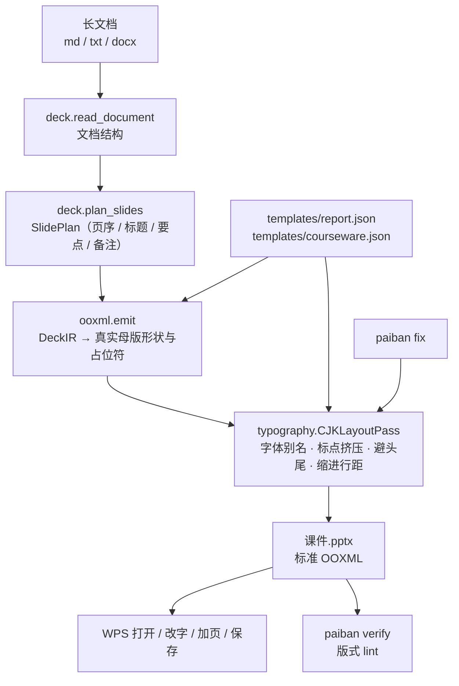

[English](./README.en.md) | **简体中文**

<div align="center">
  <a href="https://github.com/SuperMarioYL/paiban">
    
  </a>
</div>

<p align="center">
  <a href="https://github.com/SuperMarioYL/paiban/actions/workflows/ci.yml"></a>
  
  
  
  
</p>

<h3 align="center">Agent 能把长文变 deck，Paiban 补上中文版式那一层</h3>

<p align="center">
一条命令把课程稿或汇报稿变成 WPS 里能原生打开、继续编辑、保存后版式不崩的 <code>.pptx</code>。<br>
中文字体别名回退、标点挤压与避头尾、首行缩进 2 字符、行距 1.5 —— 全部落在 OOXML 属性上。
</p>

##  为什么需要 Paiban

Agent 把长文档变成「原生可编辑的 deck」这件事已经成立，但生成层默认了一套拉丁字距与字体假设：中文字体要按别名回退、全角标点要挤压、段落要按中文规范给缩进和行距。这些不在生成层的职责里，于是交付动作从「生成」退回成「逐页手工重排」——字体方块、引号把行撑开、行距缩进对不齐，一页一页改。

Paiban 接的就是「生成之后、交付之前」的那一层：**中文版式引擎 + WPS 原生往返**。它不是某个工具的汉化版，而是一层确定性的 OOXML 改写——同一份输入跑两次，逐属性一致。

三条边界说清楚：

- **模型只做语义分段**。页序、标题、要点、备注可以交给 DeepSeek；版式永远是代码，模型不写任何 OOXML 属性。
- **产物是标准 OOXML**。真实母版形状与占位符，没有图片兜底；不驱动 WPS 进程、不要求装插件。
- **交付面是 WPS**。目标版本区间是 WPS Office 2019 及以上（含 WPS 365），这是声明范围而不是实测结论，见[已知限制](#已知限制)。

##  安装

需要 Python 3.12 及以上。

```bash
git clone https://github.com/SuperMarioYL/paiban
cd paiban
pip install -e .
```

装好后命令名就是 `paiban`。PyPI 包发布之后可以直接 `pip install paiban`，在此之前请从源码安装。

想跑测试就装上开发依赖：`pip install -e ".[dev]"`。

##  快速开始

仓库自带一份真实课程稿 `fixtures/sample-longdoc.md`，下面三条命令就是完整的第一次路径（无 key 也能跑完，全部本地、无服务端、无数据库）：

```bash
paiban build fixtures/sample-longdoc.md -o 课件.pptx --template courseware   # 长文档 → deck
paiban verify 课件.pptx                                                     # 版式 lint
# 双击 课件.pptx 用 WPS 打开：改一段文字、复制一页、保存
```

`build` 的输出（实测，见 [docs/demo-results.json](./docs/demo-results.json)）：

```text
输入      fixtures/sample-longdoc.md
模板族    courseware
页序来源  rules（未设置 DEEPSEEK_API_KEY，按文档结构规则切分）
页数      12（封面 1 + 内容 11）
改写      段落 55 / run 54 / 标点挤压 14 字
字体      别名表命中 0 / 写入默认族 54
lint      ok — 5 项检查全过
输出      课件.pptx
```

想要更贴原文语义的页序，就带上 key 再跑一次（可选，同样在 60 秒内）：

```bash
export DEEPSEEK_API_KEY=sk-...
paiban build fixtures/sample-longdoc.md -o 课件.pptx --template courseware
```

这时 `页序来源` 会变成 `deepseek（deepseek-chat）`。**没有 key 不会报错**，只是降级成按文档结构规则切分，降级原因会打印出来——规则切分只保证页序可用，不保证语义分段质量。

##  演示

下面这段是真实录制的终端会话（`docs/demo.tape`，vhs 渲染，23 秒）：长文档 → `.pptx` → 版式 lint → 直接打开文件确认属性真的写进去了。

<p align="center">
  
</p>

`paiban verify` 的完整输出：

```text
文件      课件.pptx
复核范围  只复核 .pptx 里的 OOXML 属性，不渲染、不驱动 WPS 进程
规模      12 页 / 27 个文本容器 / 55 段 / 66 个 run
lint      ok — 5 项检查全过
          font_alias [ok] 65 个中文 run：65 个东亚字体槽已解析，0 个不在别名表，0 个没有东亚字体槽
          punct_compress [ok] 6 段含连续全角标点，其中 6 段已应用挤压（负字距）
          paragraph_layout [ok] 首行缩进：42 段达标 / 0 段未达标 / 13 段不适用；行距：55 段达标 / 0 段未达标；对齐不符 0 段
          kinsoku [ok] 避头尾（eaLnBrk）：55 段已开启，0 段未开启
          real_shapes [ok] 12 页中 12 页带真实占位符，图片 0 张（Paiban 生成物应为 0）
WPS 目标版本  WPS Office 2019 及以上（含 WPS 365）
未自动验证  以下结论只能在 WPS 里人工确认：
          1. 本机是否装了别名表里的字体，以及 WPS 实际选中了哪个字体来渲染中文
          2. 标点挤压与避头尾在 WPS 里的渲染结果（行首行尾半宽、禁则处理是否生效）
          3. 在 WPS 里改字 / 复制页 / 保存之后版式是否保持（需要人工往返一次）
```

不用打开 WPS 也能确认版式确实落在属性上——直接看文件里的 XML：

```bash
unzip -p 课件.pptx ppt/slides/slide2.xml | grep -oE '(a:ea typeface|spcPct val|indent)="[^"]*"' | sort -u
```

```text
a:ea typeface="Microsoft YaHei"
indent="558800"
spcPct val="150000"
```

三个字体槽里的东亚槽是 `Microsoft YaHei`（中文不会落到方块字体上），`indent="558800"` 是 22pt 字号下 2 字符的首行缩进（2 × 22pt × 12700 EMU/pt），`spcPct val="150000"` 是行距 1.5。

##  用法

### `paiban build`：长文档 → deck

```bash
paiban build 课程稿.md -o 课件.pptx --template courseware
```

| 参数 | 说明 |
| --- | --- |
| `SOURCE` | 输入长文档：`.md` / `.markdown` / `.txt` / `.docx` |
| `-o, --out` | 输出 `.pptx`；缺省与输入同名、换后缀 |
| `-t, --template` | 模板族：`report`（汇报，缺省）或 `courseware`（课件） |
| `--model` | DeepSeek 模型名，缺省 `deepseek-chat` |

页序来自文档结构：封面用文档标题，内容页的标题取章节标题，要点优先取该章节的列表项（没有列表项时用正文段落），正文段落进备注当讲稿。一页最多 6 条要点，超出自动出「（续）」页，不丢内容。

### `paiban verify`：版式 lint

```bash
paiban verify 课件.pptx                 # 按内置中文版式规范判
paiban verify 课件.pptx -t courseware   # 按某个模板族的版式参数判期望值
```

| check | 看什么 | 出现 `warn` 说明 |
| --- | --- | --- |
| `font_alias` | 中文 run 的东亚字体槽 | 有中文 run 没有东亚字体槽，或槽里的字体不在别名表 |
| `punct_compress` | 含连续全角标点的段落 | 该挤压的段落没有负字距 |
| `paragraph_layout` | 首行缩进 / 行距 / 对齐 | 缩进不是 2 字符、行距不是 1.5、或对齐与模板不符 |
| `kinsoku` | `eaLnBrk` | 段落没有显式打开东亚换行与禁则 |
| `real_shapes` | 占位符与图片 | 有页面没有占位符，或生成物里出现了图片 |

全部 `ok` 时退出码 0，出现 `warn` 时退出码 1，可以直接接进 CI 或交付前的闸门。把别的工具生成的 `.pptx` 丢进来复核一次，差异会直接显示在报告里。

### `paiban fix`：给已有 deck 补版式

```bash
paiban fix 外来稿.pptx                          # 就地改写
paiban fix 外来稿.pptx -o 修好的.pptx -t report  # 另存
```

对已有 `.pptx` 跑同一套中文版式 pass。适合拿别人的模板或别的工具出的稿子做二次交付：字体别名、标点挤压、避头尾、缩进行距全部按模板族的版式参数重写，**文本内容一个字符都不改**（挤压只拆 run）。

### 让 Agent 直接用

`skill/SKILL.md` 是这个工具给 Agent 用的说明书：什么时候该用、三条命令怎么跑、输出契约是什么、`verify` 报告怎么读、哪些结论必须人工在 WPS 里确认。把它装进支持 `SKILL.md` 的 Agent 宿主，之后就可以直接说：

```text
/paiban 把这份课程稿做成课件
```

Agent 会跑 `build` → 读出页序来源（`deepseek` 还是降级成 `rules`）→ 跑 `verify` → 把告警念给你听，而不是把规则切分说成模型分段。

##  架构

单进程 CLI，一个可执行入口，无服务端、无数据库、无微服务：



| 模块 | 职责 |
| --- | --- |
| `cli.py` | 可执行入口：`build` / `verify` / `fix` |
| `deck.py` | 长文档解析、SlidePlan、模板族加载、版式复核（`lint` / `verify`） |
| `typography.py` | 中文版式引擎：字体别名表、标点挤压判定、`CJKLayoutPass` |
| `ooxml.py` | DeckIR → OOXML，以及三字体槽与段落属性的低层读写原语 |
| `templates/*.json` | 内置中文模板族：母版版式映射 + 版式参数 |

`--model` 与 `--template` 是仅有的两个可调项；LLM 只影响页序，不影响任何版式属性。

##  中文版式规则

| 规则 | 落到 OOXML 的哪里 |
| --- | --- |
| **字体别名回退** | 别名表（微软雅黑 / 宋体 / 黑体 / 楷体 / 仿宋 / 等线 / 思源黑体 / 思源宋体，以及 Arial / Calibri / Times New Roman / Consolas 这类拉丁族的东亚槽）解析后写 `<a:latin>` `<a:ea>` `<a:cs>` 三字体槽；别名表外的字体保留拉丁槽、只补东亚槽，中文不会落到不可用字体上 |
| **标点挤压** | 连续全角标点（相邻两侧任一是全角标点）按半宽挤压：把 run 拆成多段，给被挤压的段写 `<a:rPr spc>` 负字距 |
| **避头尾** | `<a:pPr eaLnBrk="1">` 打开东亚换行与禁则，`<a:pPr hangingPunct="1">` 允许行尾标点悬挂；断行位置交给渲染器，本层不猜行边界、不改文本内容 |
| **段落版式** | 首行缩进 2 字符（按段落字号换算成 `<a:pPr indent>`，DrawingML 没有「字符」单位）、行距 1.5（`<a:lnSpc><a:spcPct val="150000"/>`）、段前后间距、两端对齐 |

两个内置模板族的差别在版式参数上：`report`（汇报）正文 18pt、段后 6pt；`courseware`（课件）按投影距离放大一档，正文 22pt、段后 10pt。两者都显式声明字号——不声明的话首行缩进会落到回退字号上，2 字符就不再精确。

##  配置

| 环境变量 | 作用 | 缺省 |
| --- | --- | --- |
| `DEEPSEEK_API_KEY` | 启用 DeepSeek 语义分段 | 不设置 → 按文档结构规则切分 |
| `DEEPSEEK_BASE_URL` | OpenAI 兼容网关地址 | `https://api.deepseek.com` |

模板族是 JSON，同时带「母版 / 占位符映射」和「版式参数」两部分：

```json
{
  "name": "courseware",
  "layouts": { "cover": 0, "content": 1, "section": 2, "end": 5 },
  "title": { "font": "微软雅黑", "font_size_pt": 40, "first_line_indent_chars": null,
             "line_spacing": 1.5, "space_before_pt": 0, "space_after_pt": 6, "alignment": null },
  "body":  { "font": "微软雅黑", "font_size_pt": 22, "first_line_indent_chars": 2,
             "line_spacing": 1.5, "space_before_pt": 0, "space_after_pt": 10, "alignment": "just" }
}
```

`layouts` 的值是母版 `slide_layout` 序号；`title` / `body` 的键就是版式参数字段，缺省项走默认值，字段为 `null` 表示不写该属性、保留母版继承。完整 schema 见 `deck.load_template()` 的 docstring。v0.1 只内置这两个模板族，不支持导入外部模板。

##  付费

核心 CLI、版式引擎和两个内置模板族是 MIT 开源的：本地跑、用你自己的 DeepSeek key。付费面是**模板族资产**和**托管按次**两条——第一条现在就能买，第二条排在 v0.3。

### 1. 中文模板族包（现在就能买）

模板族是这套产品的价值单元：一份 JSON 就是一套母版映射 + 中文版式参数，可以单独授权。内置的 `report` / `courseware` 是通用档；面向具体场景的行业模板族（培训、政企、高校课件）按族授权。

| 规格 | 试点价 |
| --- | --- |
| 单族授权 | ¥299 / 族 |
| 全家族授权（个人 / 小机构） | ¥999 |

v0.1 没有账号体系也没有在线支付，所以走**收款即交付**：在面包多 / 爱发电 / 知识星球下单，微信或支付宝收款，交付模板族 zip + 一份激活说明（放进 `src/paiban/templates/` 就能用 `--template` 调用）。企业内训与培训机构是第一批目标用户，按席或按项目报价请开一个 issue 说明场景。

### 2. 托管按次（v0.3，尚未上线）

不想装环境、不想配 key 的讲师与机构，可以把长文档传上去、拿一份 WPS 原生可编辑的 `.pptx` 回来。计划价格 ¥2 / 份，讲师 ¥99 / 月，机构 ¥99 / 席 / 月；走阿里云函数计算 + 微信支付。**现在还没有这个东西**——v0.1 只有本地 CLI，托管层上线前唯一能付钱的地方是模板族包。

##  路线图

- **v0.1（当前）** — 中文版式引擎落到 OOXML 属性上、长文档 → deck、WPS 往返验收清单、双语 README、Agent Skill，golden 属性回归全绿。
- **v0.2** — 更多模板族；按 WPS 版本差异补齐标点挤压规则；`verify` 增加机器可读输出（JSON），方便接进交付流水线。
- **v0.3** — 托管按次：上传长文 → WPS 原生可编辑 `.pptx`，含账号与在线支付。

##  已知限制

- **WPS 渲染没有被自动验证。** `verify` 只复核 `.pptx` 里的 OOXML 属性，不渲染、不驱动 WPS 进程。目标版本区间是 WPS Office 2019 及以上（含 WPS 365），这是声明范围而不是实测结论。
- **画布尺寸沿用 python-pptx 内置母版的 10 × 7.5 英寸（4:3）。** v0.1 不支持 16:9。
- **只吃 markdown / txt / docx。** PDF、图片、视频不做。
- **只做中文版式。** 不含日文 / 韩文的标点与版式规则。
- **不生成图片、数据图表、音频旁白、转场动画。** 也不做可视化模板编辑器与外部模板导入。
- **一页最多 6 条要点。** 超出自动出「（续）」页。

### WPS 往返验收清单

这五步必须人工在 WPS 里执行，`verify` 替代不了：

| 步骤 | 动作 | 期望 |
| --- | --- | --- |
| 打开 | 双击 `.pptx` 用 WPS 打开 | 中文字体不回退、没有方块 |
| 改字 | 在任意一页改一段文字 | 首行缩进 2 字符与行距 1.5 仍在 |
| 加页 | 复制一页或新建一页 | 新版式跟着母版走，缩进行距一致 |
| 保存 | 保存后重新打开 | 属性没被 WPS 改写回默认值 |
| 复核 | 对保存后的文件重跑 `paiban verify` | 告警与保存前一致 |

### 排错

| 现象 | 原因 / 处理 |
| --- | --- |
| `页序来源` 是 `rules` | 没有 `DEEPSEEK_API_KEY`，或 DeepSeek 调用失败；按括号里的原因处理，或接受规则切分 |
| `不支持的输入格式` | 输入是 PDF / 图片 / 视频等 v0.1 不吃的格式，先转成 markdown / txt / docx |
| `没有内置模板族` | `--template` 只接受 `report` / `courseware` |
| 封面标题是文件名 | 文档里没有一级标题（`.txt` 也没有可识别的编号标题行），加一行标题即可 |
| `verify` 报 `font_alias` warn | 稿子里有别名表外的字体；把该字体补进别名表，或改稿子里的字体名 |

## 开发

```bash
pip install -e ".[dev]"
python -m pytest
```

`tests/test_typography.py` 测版式引擎本身（别名表、挤压判定、段落属性、确定性）；`tests/test_golden_pptx.py` 是端到端属性回归，期望值在 `fixtures/golden/expected-props.json`——改解析或改版式参数会让它变红，这是设计目标。

录制演示 GIF：`vhs docs/demo.tape`（需要 vhs + ttyd + ffmpeg），产物是 `assets/demo.gif`。

<p align="center"><sub><a href="./LICENSE">MIT</a> © 2026 SuperMarioYL</sub></p>
